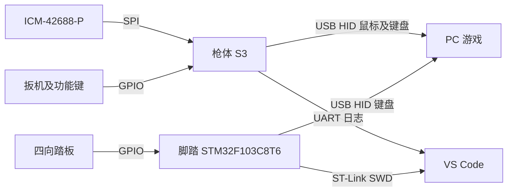

# GunGameSimulator 总体设计与实施规划

> V1 行为规则已冻结在 [ARCHITECTURE.md](docs/ARCHITECTURE.md)，实施顺序及交接要求见 [IMPLEMENTATION_PLAN.md](docs/IMPLEMENTATION_PLAN.md)。本文保留总体背景和当前实现状态，出现冲突以架构规范为准。固件已按规范重构，硬件验收尚未执行。

## 1. 产品范围

ESP32-S3 N16R8 + ICM-42688-P 构成有线 FPS 控制器。枪体输出 USB HID 鼠标与键盘，独立脚踏输出 WASD 键盘。第一版采用相对角速度瞄准，不承诺绝对指向屏幕；HID 使用操作系统内置驱动，具体游戏仍需验证输入行为。

第一版不包含无线、光学定位、震动、自动压枪或连点脚本。N16R8 性能与容量足够，实时路径使用内部 RAM，当前不依赖 PSRAM。默认脚踏现使用 STM32F103C8T6，ESP32 脚踏保留为参考后端。其他 MCU 按 HAL 契约新增适配，见 [STM32 脚踏指南](docs/STM32_PEDAL.md)。

## 2. 总体架构

软件已拆为可移植应用 `gg_app`、纯 C 领域模块 `gg_core`、标准 C HAL 接口及独立 `platform/esp32` 后端。硬件替换遵守 [HAL 移植指南](docs/HAL_PORTING.md)，不将 SDK 或设备寄存器重新引入上层。

枪体 ESP-IDF 和脚踏 PlatformIO 工程分别构建、烧录与验收。下述 HID/JTAG 双模式仅适用于 ESP32。正常 HID 联调用 UART 日志；单步调试使用关闭 HID 的构建，保留内置 USB JTAG，详见 [调试指南](docs/DEBUGGING.md)。

## 3. 瞄准设计决定

目标链路：新样本及时间戳 → 零偏扣除 → 坐标映射 → 低通 → 可配置死区 → 线性增益 → 按实际 dt 积分 → 小数余量 → HID 整数计数。

`counts = counts_per_degree × gain × (gyro_dps - bias_dps) × dt_seconds`

- 不维护绝对 yaw，但残余零偏仍累积为鼠标漂移；不能宣称 rate mode 无漂移。
- 首先建立线性增益基线。非线性、ADS 增益作为可选项，并记录游戏灵敏度和开镜倍率。
- Recenter 定义为 clutch：按住暂停运动输出，将枪移回舒适姿势，松开后继续。暂停期间丢弃积压和余量，不回放运动，也不能让游戏镜头自动归中。
- 校准与 clutch 分开。静置窗口检查有效样本、均值范围、方差和加速度稳定性，失败保留旧 bias。自动温漂跟踪在验证不会吸收缓慢瞄准后再启用。
- 低角速度且加速度模长约 1g 不能证明静止，匀速缓慢水平转动也满足条件。
- 第一版约定基本水平握枪；后续用重力方向补偿横滚。固定 Y/Z 映射不能支持任意倾斜握姿。
- 死区必须接受缓慢连续运动测试。传感器、HID 计数、游戏转角的分辨率分别评估。
- ADS 首版限定“按住开镜”；MCU 不知道游戏实际开镜状态，允许关闭设备端降敏。

## 4. 实时性与资源

| 环节 | 初始目标 | 验证 |
|---|---|---|
| IMU | 1–2 kHz ODR，新样本驱动 | DRDY/FIFO 时间戳、丢样统计 |
| 瞄准与按键 | 1 kHz 目标周期 | 原始 dt、超期次数、P95/P99/最大值 |
| USB | full-speed 端点 1 ms 轮询 | USB 抓包与主机接收统计 |
| 脚踏 | 1 kHz 扫描，5 ms 去抖起点 | 接点到输入事件时间差 |
| 滤波 | 先验证 55 Hz 基线，再调截止 | 静止噪声、动作响应 |

1000 Hz 不等于 1 ms 延迟，也不要求静止时每秒发送 1000 个相同报告。55 Hz 一阶低通的低频群延迟约 2.9 ms，还需加上传感器滤波、采样、调度、USB 和整数计数量化。先测量，再冻结指标，不承诺未验证的 2–5 ms 或 0.1° 精度。

热路径不逐样本打印、不写文件、不动态分配。USB 忙时采用有界运动积累，并保证必要的 press/release 顺序。断线丢弃旧运动，重连按当前按键状态同步。

## 5. 当前代码与目标差距

“已有代码”不代表已通过板上验收。代码已按 V1 重构，剩余差距集中在实机标定与验收。

| 项目 | 当前代码 | 计划 |
|---|---|---|
| USB | 复合 HID、固定事件队列、快照 FIFO、完成确认、溢出/超时/重连恢复 | 枚举与主机侧延迟实测 |
| IMU | 1 kHz ODR、DRDY 新样本、时间戳、非法值处理、非阻塞恢复 | 实机采样间隔与丢样统计 |
| 瞄准 | 固定 Y/Z、55 Hz LPF、默认死区 0、线性 3 counts/°、三档 0.6/1.0/1.2 | 游戏内 counts/°、死区与 ADS 标定 |
| 校准 | 2 s 窗口、原子提交、失败保留旧 bias、组合手势手动校准、无自动跟踪 | 实机静置与慢速转动验证 |
| Recenter | clutch 与窗口校准独立交互 | 实机验证无旧位移回放 |
| 调试 | HID/JTAG 双模式构建、UART 统计、JTAG 桩 | 板上断点与四组合验收 |
| 参数保存 | 编译期宏 | 后续 NVS、版本及有效范围检查 |

主机离线测试位于 `tests/`，使用真实纯 C 模块和受控时钟/模拟 USB 事件。硬件未验证项：真实枚举、轴符号、采样间隔、端到端延迟、按键与 IMU 故障注入。

## 6. 实施里程碑

| 阶段 | 工作 | 完成条件 |
|---|---|---|
| M0 环境 | VS Code、ESP-IDF、UART、JTAG | 两工程构建成功，UART 有日志，断点停在 app_main |
| M1 连通 | SPI、WHO_AM_I、GPIO、HID | IMU ID=0x47；所有按键按下释放正确；独立枚举 |
| M2 瞄准 | 线性增益、窗口校准、clutch、新样本管理 | 慢速移动可控；clutch 松开无跳变；失败不污染 bias |
| M3 可靠性 | 拥塞、IMU 故障、USB 重连 | 无旧运动回放、无持续卡键；故障可诊断 |
| M4 脚踏 | 去抖、组合键、承力、长线 | 组合和释放正确；结构不压坏开关 |
| M5 标定 | 游戏灵敏度、ADS、姿态、延迟 | 保存实测记录，完成单局体验，冻结 V1 参数 |
| M6 可选增强 | 横滚补偿、非线性、NVS、震动 | 每项与基线对比，震动不污染瞄准 |

光学/Lighthouse 单独立项，需要定位、坐标标定、遮挡恢复和主机桥接。即使有绝对姿态，普通 FPS 的相对鼠标接口也不能自动实现绝对镜头闭环。

## 7. 详细文档

- [枪体设计](firmware/gun-controller/DESIGN.md)
- [脚踏设计](firmware/pedal-controller/DESIGN.md)
- [硬件与接线](docs/HARDWARE.md)
- [VS Code 调试](docs/DEBUGGING.md)
- [测试计划](docs/TEST_PLAN.md)

版本冻结时提交依赖锁文件和测试记录。默认 VID/PID 是原型占位，发布前需确认标识分配及许可。

